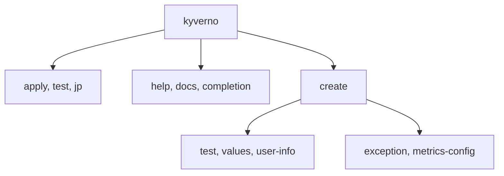

# The Kyverno CLI Toolbox

Astronaut, the scanner is on board and it reports the right serial number. Now learn what else is in the toolbox. The Kyverno command-line interface (CLI) is more than `apply`, `test` and `jp`. It has helper commands that print its own manual, finish your typing, and write starter files so you never begin with a blank page.

Think of the CLI as a handheld rulebook scanner with a few extra buttons. Some buttons do the checking. Others help you find the right button, or print a fresh form for you to fill in. In the exam, speed counts, so knowing these helpers saves minutes.

The checking commands sit on one branch. The helper commands and the `create` scaffolds sit on the others.

## Learning objectives

After this module you can:

- Walk the subcommand tree with `--help`, read the usage, examples and flags of any command, and use the global flags `-v` and `--kubeconfig`.
- Reveal the experimental commands with the `KYVERNO_EXPERIMENTAL` switch, and print the command reference with `kyverno docs`.
- Generate a completion script for `bash`, `zsh`, `fish` or `powershell`, and say where each shell reads it.
- Make the same binary answer to `kubectl kyverno` by giving it the plugin name.
- Scaffold a test file, a values file and a user-info file with `kyverno create`, and name the other `create` helpers.

## Before you start

You need a working `kyverno` binary and the basic shell habits from installing it. No policy knowledge is needed.

### What you should already know

- **How to run a command and read its output.** The commands here are short and most of them print text.
- **What a `PATH` is.** It is the tool rack the console searches when you type a command name.

### What is waiting in your playground

Your playground is a training solar system (a `kind` cluster) with the Kyverno controller `v1.13.2` running and the `kyverno` CLI `v1.13.2` already installed. The folder `/root/toolbox` holds three files to point the helpers at: the policy `policy.yaml` (`ClusterPolicy` `require-team-label`), and two Pod files, `compliant-app.yaml` (with a `team` label) and `legacy-app.yaml` (without one). You are the administrator of the terminal.

## How this module is organised

1. **[Finding Your Way Around the CLI](./course-01-finding-your-way.md)**: the command tree, how to read a help page, the global flags, the experimental switch and `kyverno docs`.
2. **[Shell Completion and the Plugin Name](./course-02-completion-and-the-plugin-name.md)**: completion scripts for every shell, and how `kubectl kyverno` works.
3. **[Scaffolding Files with `kyverno create`](./course-03-scaffolding-with-create.md)**: the helpers that write starter files. It ends with your graded mission.
4. **[Summary](./course-04-summary.md)**: what you learned, your mission, and cleaning up.

## Why this matters

A policy author spends the day in the terminal. A person who can find any flag in seconds, finish commands with the tab key and scaffold a file in one line works much faster than one who searches the web. The exam gives you a terminal and a clock, and these habits are what you bring to it.

Launch your playground now, and keep it running next to you while you read the parts:

<!-- astrona:playground -->
