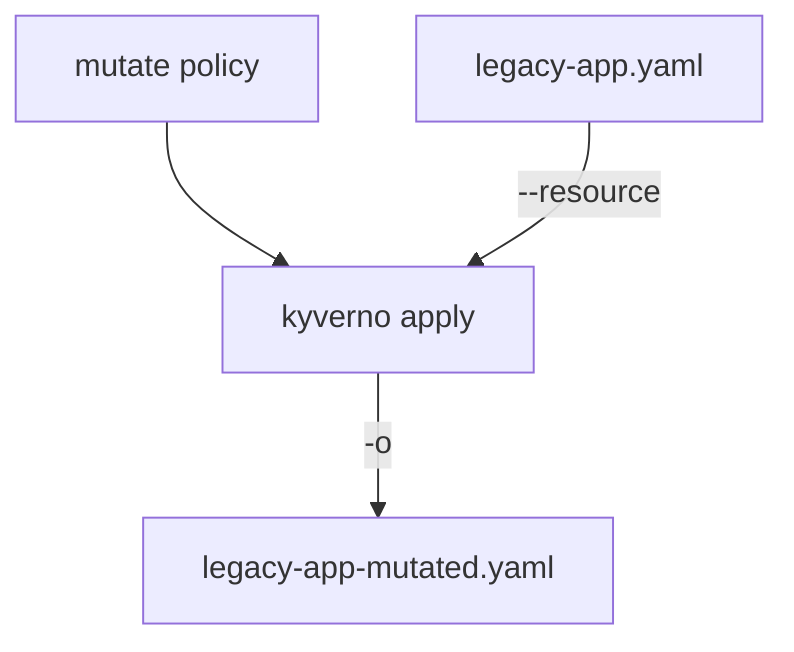

# Mutating Resources And Saving The Result

Astronaut, a `validate` rule is an inspector with a clipboard: it says yes or no. A `mutate` rule is a repair crew. When a ship arrives with a marking missing on its hull, the crew paints it on before the ship docks. `kyverno apply` lets you watch the crew work on a blueprint (a resource file) in the simulator, with no real ship involved.

This part runs a `mutate` rule, saves the result with `-o`, and shows why the original file never changes. Run the commands in the playground terminal.



The source file goes in, a patched copy comes out, and the source stays as it was.

## Run your first mutation

A mutate rule has a `match` block like any rule. Instead of `validate`, it has a `mutate` block that says what to change.

### Save the policy

<!-- astrona:playground:renew -->

Save this as `clusterpolicy-add-default-team.yaml`. It adds the label `team: unassigned` to every Pod, but only when the Pod has no `team` label:

```yaml
apiVersion: kyverno.io/v1
kind: ClusterPolicy
metadata:
  name: add-default-team
spec:
  rules:
    - name: add-team-label
      match:
        any:
        - resources:
            kinds:
              - Pod
      mutate:
        patchStrategicMerge:
          metadata:
            labels:
              +(team): unassigned
```

The `patchStrategicMerge` block is the paint job: it describes the part of the Pod to add. The `+(team)` is an add anchor. It means "add this label only if it is missing", so an existing label is never painted over.

### Run it on a Pod with no label

Save the policy in the folder with the example files, `/root/apply-mutate`, and run it on `legacy-app.yaml`. `-o` names the file for the result:

```sh
cd /root/apply-mutate
kyverno apply clusterpolicy-add-default-team.yaml --resource legacy-app.yaml -o legacy-app-mutated.yaml
```

The CLI prints the patched Pod and counts one `pass`. Check that the new file has the label:

```sh
grep team legacy-app-mutated.yaml
```

The output is one line, `team: unassigned`. The crew painted the missing marking. Now check that the original blueprint stayed as it was:

```sh
grep -c team legacy-app.yaml
```

This prints `0`: there is no `team` text in the source. `kyverno apply` only reads the resource file. The result goes to the screen and to the `-o` file, never back into the source.

## Run it on a Pod that already has the label

The second example file already has a marking. Run the same policy on it:

```sh
kyverno apply clusterpolicy-add-default-team.yaml --resource compliant-app.yaml -o compliant-app-mutated.yaml
```

The CLI skips this Pod for the mutate rule, because the `+(team)` anchor sees that the label exists. The label stays `team: checkout`. A mutate rule that finds nothing to change is not an error and not a failure.

## Where the result goes

`-o` (long form `--output`) takes a path. Use a file name for one resource. The path can also be a folder that already exists, and the CLI then writes one file per resource.

> [!TIP]
> Delete the old output file before you run again. Do not trust an old file: if a run writes nothing, the old content stays and you may read yesterday's answer.

There is a second way to get the result out: `-i` (long form `--stdin`). It is meant to send the patched resource straight into another command, such as `kubectl`. The text the CLI prints around the resource is different between versions, so for a script write the file with `-o` and apply that file.

### Send the patched Pod to the cluster

The playground has a cluster but no Kyverno controller, so nothing mutates on its own. Create the Pod from the file the CLI wrote, and read its labels:

```sh
kubectl apply -f legacy-app-mutated.yaml
kubectl -n apps get pod legacy-app --show-labels
```

The `LABELS` column shows `team=unassigned`. The label is on the Pod because you applied the patched file. A real Kyverno controller would do the same patch for you at admission. `apply` shows you the result in advance.

## Common pitfalls

> [!WARNING]
> - **Expecting the source file to change.** `kyverno apply` never edits the resource you pass. Read the `-o` file or the screen.
> - **Reading an old output file.** A failed run may leave the previous file behind. Delete it first.
> - **Using a plain label instead of the add anchor.** `team: unassigned` without `+()` paints over an existing label. Use `+(team)` when you only want to fill a gap.
> - **Looking for `fail` on a mutate rule.** A mutate rule reports `pass` when it changed the resource and a skip when it had nothing to do.
