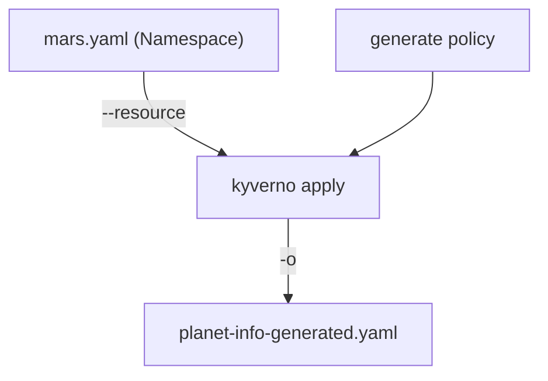

# Generating Resources From A Trigger

Astronaut, think of a base-building crew. When a new planet is claimed, the crew drops a supply crate on it, with a welcome note inside. Nobody asked for the crate by hand: the claim itself is the trigger. A `generate` rule works the same way. When a resource of the matched kind appears, such as a `Namespace`, Kyverno builds another resource next to it.

`kyverno apply` can run a `generate` rule offline. You pass the trigger as a file and the CLI shows the crate it would build. Run the commands in the playground terminal.



The trigger goes in, the generated resource comes out, and nothing is created in the cluster.

## Run your first generation

### Save the policy

<!-- astrona:playground:renew -->

Save this as `clusterpolicy-planet-info.yaml` in `/root/apply-mutate`. It builds a `ConfigMap` named `planet-info` inside every new `Namespace`:

```yaml
apiVersion: kyverno.io/v1
kind: ClusterPolicy
metadata:
  name: planet-info
spec:
  rules:
    - name: create-planet-info
      match:
        any:
        - resources:
            kinds:
              - Namespace
      generate:
        apiVersion: v1
        kind: ConfigMap
        name: planet-info
        namespace: "{{request.object.metadata.name}}"
        synchronize: true
        data:
          data:
            owner: mission-control
```

Three parts matter:

- `match` names the trigger: a `Namespace`.
- `generate` describes the crate: its kind, its name and where it goes. The `namespace` value is a variable. `{{request.object.metadata.name}}` means "the name of the trigger", so the crate lands in the new planet.
- The inner `data` block is the content of the `ConfigMap`. The outer `data` belongs to the rule, the inner one is the `ConfigMap`'s own `data`.

### Run it on the Namespace file

```sh
cd /root/apply-mutate
rm -f planet-info-generated.yaml
kyverno apply clusterpolicy-planet-info.yaml --resource mars.yaml -o planet-info-generated.yaml
```

Read the file the CLI wrote:

```sh
cat planet-info-generated.yaml
```

It holds a `ConfigMap` named `planet-info` in the namespace `mars`, with `owner: mission-control` in its data. The `mars` in the namespace field came from the trigger file, through the variable. The exact lines the CLI prints on screen change between versions, so trust the file you wrote with `-o`.

## What apply does not do

`kyverno apply` shows the crate. It never creates it. Check the cluster:

```sh
kubectl get configmap planet-info -n mars
```

The answer is `NotFound`. The playground has no Kyverno controller, and `apply` only writes a file. To create the crate for real you would apply the generated file yourself, or let a real Kyverno controller do it.

## Generate by cloning

A generate rule can also copy an existing resource instead of describing a new one. This is called `clone`. The rule names a source, such as a `ConfigMap` in the namespace `default`, and Kyverno copies it into each new planet.

Offline, there is nothing to copy from: the source lives in a cluster, and `apply` with files cannot see it. Test clone rules with `--cluster`, or on a real cluster. Data-based rules, like the one above, work fully offline.

## Common pitfalls

> [!WARNING]
> - **Expecting the resource in the cluster.** `apply` writes a file and nothing else. Create the generated resource yourself if you want it live.
> - **Putting the trigger kind in the wrong place.** The `match` kind is what triggers the rule. The `generate` kind is what gets built. They are usually different.
> - **Forgetting the namespace variable.** A hard-coded namespace puts every crate on the same planet. Use `{{request.object.metadata.name}}` when the trigger is a `Namespace`.
> - **Testing a clone rule offline with no cluster.** The source cannot be read, so the result cannot be trusted.
