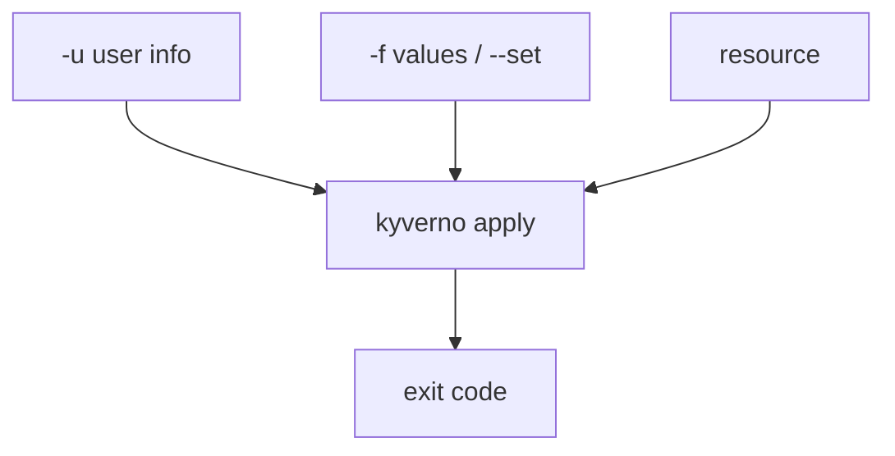

# Request Data: User Info, Operation And Namespace Labels

Astronaut, a real admission request carries more than the resource. It says who is asking, what they want to do, and which planet the resource lands on. In a file-only run, none of that exists. The CLI has to be told, the same way a flight simulator has to be told the weather.

This part shows three flags and files that supply that request data: the user info file, the operation, and the labels of a namespace. Run the commands in the playground terminal.



Each flag fills one piece of the request. The exit code tells you whether the rule passed.

## Who is asking: the user info file

Some rules let certain people through. A rule like that uses an `exclude` or `match` block with roles. Offline, the CLI does not know your role, so you give it an ID badge: a user info file.

### Save a policy that has a guest list

<!-- astrona:playground:renew -->

Save this as `clusterpolicy-flight-director.yaml` in `/root/apply-mutate`. It rejects every Pod change, except from the cluster role `flight-director`:

```yaml
apiVersion: kyverno.io/v1
kind: ClusterPolicy
metadata:
  name: flight-director-only
spec:
  validationFailureAction: Enforce
  background: false
  rules:
    - name: directors-only
      match:
        any:
        - resources:
            kinds:
              - Pod
      exclude:
        any:
        - clusterRoles:
            - flight-director
      validate:
        message: "Only the flight director may change Pods."
        deny: {}
```

### Run it with no badge

```sh
cd /root/apply-mutate
kyverno apply clusterpolicy-flight-director.yaml --resource legacy-app.yaml
echo $?
```

The CLI reports one `fail`, and `echo $?` prints `1`. Nobody showed a badge, so nobody is on the guest list.

### Show the badge with `-u`

Save the badge as `director.yaml`:

```yaml
apiVersion: cli.kyverno.io/v1alpha1
kind: UserInfo
clusterRoles:
  - flight-director
```

`clusterRoles` lists the roles the made-up user has. A `userInfo` block with a `username` can also be set, for rules that match on a user name. Run again, with `-u` (long form `--userinfo`):

```sh
kyverno apply clusterpolicy-flight-director.yaml --resource legacy-app.yaml -u director.yaml
echo $?
```

The rule now skips the Pod, because the badge puts the user on the `exclude` list, and `echo $?` prints `0`. The policy did not change. Only the request data did.

> [!NOTE]
> The user info file does not edit the resource. It is a description of the requester, used by `match`, `exclude` and the `request.userInfo` variables.

## What they want to do: the operation

Rules can react to the kind of request: `CREATE`, `UPDATE` or `DELETE`. A rule reads it from `request.operation`. Offline, the CLI treats the resource as a new one, so the operation is `CREATE`. Change it with `--set`:

```sh
kyverno apply clusterpolicy-flight-director.yaml --resource legacy-app.yaml --set request.operation=UPDATE
```

`--set` takes the same dotted names a values file uses. Use it for one quick answer. For several answers, put them in a file.

## Which planet it lands on: namespace labels

A rule can match on the labels of the namespace, with a `namespaceSelector`. The resource file does not carry those labels, so the values file gives them:

```yaml
apiVersion: cli.kyverno.io/v1alpha1
kind: Values
namespaceSelector:
  - name: apps
    labels:
      env: production
```

Pass it with `-f`:

```sh
kyverno apply policy.yaml --resource legacy-app.yaml -f values.yaml
```

The entry `name: apps` must match the namespace of the resource. A rule that matches `env: production` then sees that label.

## Which flag for which answer

| The rule asks about | Give it with |
| --- | --- |
| The user's roles or name | `-u user-info.yaml` |
| `request.operation` | `--set request.operation=UPDATE` or a values file |
| The labels of a namespace | `namespaceSelector` in a values file |
| A custom variable or a `configMap` lookup | `-f values.yaml` or `--set` |

## Common pitfalls

> [!WARNING]
> - **Forgetting `-u` for a role rule.** Without a badge, a role-based `exclude` never applies, and the Pod fails.
> - **Putting `subjects` in the user info file.** Stick to `clusterRoles` and `userInfo`.
> - **Wrong namespace name in `namespaceSelector`.** The `name` must be the namespace the resource lives in, or the labels are not found.
> - **Reading only the screen.** In a script, read `$?`. Exit code `0` means pass.

## Your mission: Mutate & Generate Apply Lab

You can now preview a mutation, preview a generation, and pass in the identity of the requester. Prove it in a graded mission: mutate a Pod and save the result, generate a `ConfigMap` for a new planet, write a user info file that lets a policy pass, and send the repaired Pod to the cluster.

Pause the playground first, so the mission has the memory it needs:

```sh
astrona stop ats-009-playground-020-02
```

Start the mission, then grade it when you think you are done:

```sh
astrona run --git ssh://git@github.com/astrona-io/ATS009.git -c sections/section-020/module-02/labs/lab-01
astrona submit -c sections/section-020/module-02/labs/lab-01
```

Read the task in [`question.md`](./labs/lab-01/question.md) and solve it on your own first. When the mission is done, remove it and start the playground again:

```sh
astrona destroy ats-009-lab-010
astrona start ats-009-playground-020-02
```
