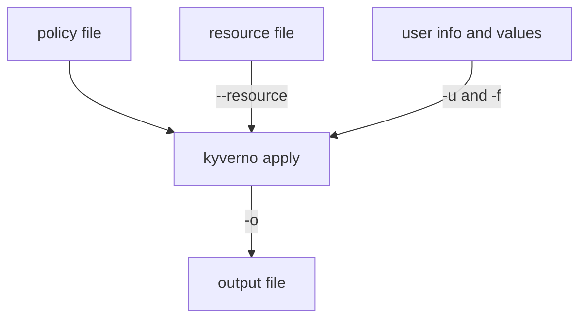

# Mutate And Generate With apply

Astronaut, not every rule on the fleet rulebook turns ships away. Some rules repair the blueprint before the ship docks, and some build things for a new planet. These are `mutate` and `generate` rules. `kyverno apply` can run them offline, so you see what a rule would do to a resource before a real cluster ever does it, and you can save the result to a file.

The command reads a policy and a resource. It can also read made-up request data: who is asking and what they want to do. It writes the patched or generated resource to the file you name with `-o`.

## Learning objectives

After this module you can:

- Run a `mutate` rule with `kyverno apply` and save the patched resource with `-o`.
- Explain why `apply` never edits the source file and how `-i`/`--stdin` differs from `-o`.
- Run a `generate` rule with `kyverno apply` and read the resource it builds from a trigger.
- Pass the identity of the requester with a user info file (`-u`/`--userinfo`) so `match` and `exclude` blocks that use roles can be checked.
- Supply request data with a values file or `--set`: `request.operation` and the labels of a namespace.

## Before you start

This module builds on the plain `kyverno apply` command: a policy file, a resource file and `--resource`. The playground has the tool ready.

### What you should already know

- **How to run `kyverno apply` on a Pod file** and read its summary line.
- **What a `ClusterPolicy` rule looks like.** A rule has a `match` block and one action: `validate`, `mutate` or `generate`.
- **Basic `kubectl`.** Applying a file and reading labels.

### What is waiting in your playground

The playground is a training solar system (a `kind` cluster) with the `kyverno` CLI `1.13.2`. It has no Kyverno controller: only the CLI runs the rules. The files `legacy-app.yaml` (a Pod with no labels), `compliant-app.yaml` (a Pod with the label `team: checkout`) and `mars.yaml` (a `Namespace`) are in `/root/apply-mutate/`. You write the policies yourself. The graded mission starts its own cluster, with its own files.

## How this module is organised

1. **[Mutating Resources And Saving The Result](./course-01-mutating-resources-and-saving-the-result.md)**: running a `mutate` rule, `-o`, and what `-i` does.
2. **[Generating Resources From A Trigger](./course-02-generating-resources-from-a-trigger.md)**: running a `generate` rule offline and reading what it builds.
3. **[Request Data: User Info, Operation And Namespace Labels](./course-03-request-data-user-info-operation-and-namespace-labels.md)**: `-u`, `request.operation` and namespace labels. It ends with your graded mission.
4. **[Summary](./course-04-summary.md)**: what you learned, your mission, questions to check yourself, and cleaning up the playground.

## Why this matters

On a real cluster, a mutating rule changes a request before it is stored, and you cannot take the change back. A short offline run shows the result first. The exam also expects you to know which flags carry the request data into the run.

<!-- astrona:playground -->
