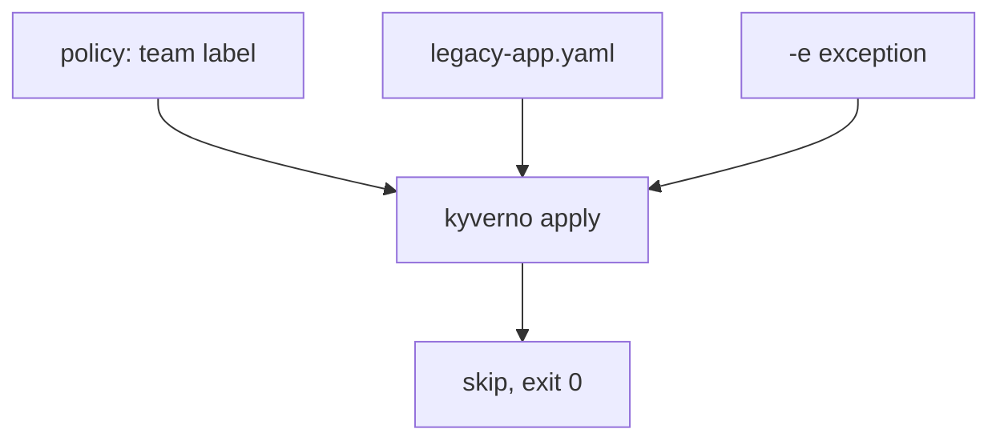

# Exceptions With -e

Astronaut, imagine an old freighter that has flown for decades without the new hull marking. The rulebook says no ship without a marking may dock. Repainting the freighter is planned for next year. Until then, the dock guard needs a signed note: "this one ship is excused from this one rule". In Kyverno, that note is a `PolicyException`.

This part writes an exception and passes it to `kyverno apply`. Run the commands in the playground terminal.



The policy would fail the Pod. The exception excuses it, so the rule is skipped.

## See the failure first

### Save a policy and two Pods

<!-- astrona:playground:renew -->

The two Pod files are already in `/root/apply-gate`. Save this policy there as `clusterpolicy-require-team-label.yaml`:

```yaml
apiVersion: kyverno.io/v1
kind: ClusterPolicy
metadata:
  name: require-team-label
spec:
  validationFailureAction: Enforce
  background: true
  rules:
    - name: check-team-label
      match:
        any:
        - resources:
            kinds:
              - Pod
            namespaces:
              - apps
      validate:
        message: "A non-empty 'team' label is required on every Pod in apps."
        pattern:
          metadata:
            labels:
              team: "?*"
```

Run it on both Pods:

```sh
cd /root/apply-gate
kyverno apply clusterpolicy-require-team-label.yaml --resource legacy-app.yaml --resource compliant-app.yaml
echo $?
```

The summary shows `pass: 1` and `fail: 1`, and `echo $?` prints `1`. `legacy-app` has no `team` label.

## Write the exception

A `PolicyException` is its own resource. It names the policy, the rules to excuse, and the resources it covers.

Save this as `legacy-exception.yaml`:

```yaml
apiVersion: kyverno.io/v2beta1
kind: PolicyException
metadata:
  name: legacy-app-exception
  namespace: apps
spec:
  exceptions:
    - policyName: require-team-label
      ruleNames:
        - check-team-label
  match:
    any:
    - resources:
        kinds:
          - Pod
        names:
          - legacy-app
```

Read it like a signed note:

- `policyName` and `ruleNames` say which rule is excused. Both must match the policy exactly.
- `match` says which resource is excused. Here it is one Pod, by name. Without a narrow `match`, the exception can cover far too many ships.
- `namespace` says where the exception lives.

> [!NOTE]
> Newer CLI versions may print a warning that the `v2beta1` API is deprecated, and that `v2` replaces it. The warning goes to the error stream. The result does not change.

## Pass it with `-e`

`-e` (long form `--exception`) takes the file:

```sh
kyverno apply clusterpolicy-require-team-label.yaml --resource legacy-app.yaml --resource compliant-app.yaml -e legacy-exception.yaml
echo $?
```

The summary line shows `pass: 1` and `skip: 1`, and the exit code is `0`. `legacy-app` is not a pass: it is a skip, because the exception excused it. Compare this with the first run. The policy file did not change. Only the note changed.

## Common pitfalls

> [!WARNING]
> - **Forgetting `-e`.** Writing the exception file does nothing until you pass it to `apply`.
> - **A name that does not match.** If `policyName` or `ruleNames` differs from the policy, nothing is excused and the Pod still fails.
> - **An exception that is too wide.** Match one Pod by name, not every Pod, or the rule stops protecting anything.
> - **Counting a skip as a pass.** An excused resource is `skip`. It was not checked and found good.
