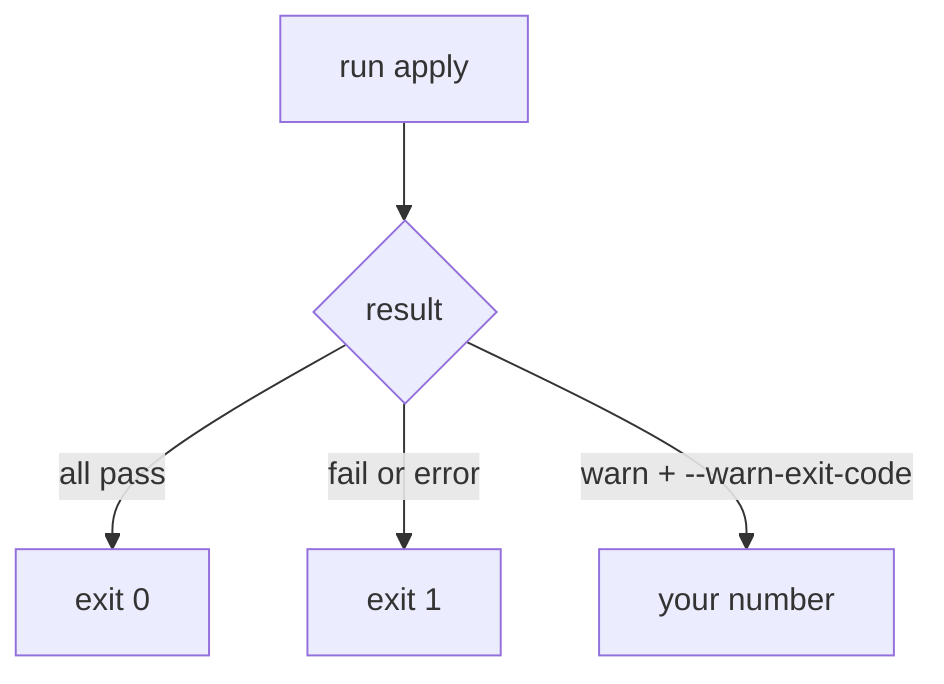

# Warnings And Exit Codes

Astronaut, a dock guard has three answers: let the ship in, stop the ship, or let it in with a note in the log. The log note is a warning. A pipeline needs to know which of the three happened, and it only reads one thing: the exit code. This part shows how `kyverno apply` chooses its exit code, and how you change it.



Failures always exit `1`. Warnings exit with the number you pick.

## The default

Run the Enforce policy from the last part on a Pod that fails:

```sh
cd /root/apply-gate
kyverno apply clusterpolicy-require-team-label.yaml --resource legacy-app.yaml
echo $?
```

You see `fail: 1` and the exit code `1`. Any `fail` or `error` makes the run exit `1`. A pipeline step stops on a non-zero code, so a failure stops the pipeline.

## Audit policies and `--audit-warn`

### Save an Audit policy

<!-- astrona:playground:renew -->

An `Audit` policy reports a violation but does not block. Save this as `clusterpolicy-audit-team-label.yaml`:

```yaml
apiVersion: kyverno.io/v1
kind: ClusterPolicy
metadata:
  name: require-team-label-audit
spec:
  validationFailureAction: Audit
  background: true
  rules:
    - name: check-team-label
      match:
        any:
        - resources:
            kinds:
              - Pod
            namespaces:
              - apps
      validate:
        message: "A non-empty 'team' label is required on every Pod in apps."
        pattern:
          metadata:
            labels:
              team: "?*"
```

By default, `apply` treats a failed rule as a failure, even in `Audit` mode:

```sh
kyverno apply clusterpolicy-audit-team-label.yaml --resource legacy-app.yaml --resource compliant-app.yaml
echo $?
```

The exit code is `1`. That surprises many people: the policy only audits, yet the gate stops.

### Make it a warning

`--audit-warn` tells the CLI to flag `Audit` policy violations as warnings instead of failures:

```sh
kyverno apply clusterpolicy-audit-team-label.yaml --resource legacy-app.yaml --resource compliant-app.yaml --audit-warn
echo $?
```

The summary now says `warn: 1` and the exit code is `0`. The guard writes the note in the log and lets the ship in.

## Give warnings their own exit code

Exit `0` hides the warning from the pipeline. `--warn-exit-code` picks a number for runs that have warnings:

```sh
kyverno apply clusterpolicy-audit-team-label.yaml --resource legacy-app.yaml --resource compliant-app.yaml --audit-warn --warn-exit-code 3
echo $?
```

The exit code is `3`. Now a pipeline can tell the three outcomes apart: `0` means clean, `3` means warnings only, `1` means real failures. A step that treats `3` as "continue but mark yellow" gives you a traffic light.

The help text says it plainly: if failures or errors are found, the run still exits `1`.

## What `--warn-no-pass` adds

`--warn-no-pass` can be used together with `--warn-exit-code`. Its help text says it raises the warning exit code when no object satisfied a policy. Use it when "nothing passed" is itself a reason to look closer. Add it to the run above and the exit code is still `3`, because there were warnings anyway.

## The exit code table

All of these were run on the same two Pods and the Audit policy:

| Flags | Exit code | Why |
| --- | --- | --- |
| none | `1` | An Audit violation counts as a failure |
| `--audit-warn` | `0` | The violation is only a warning |
| `--audit-warn --warn-exit-code 3` | `3` | Warnings exit with your number |
| `--warn-exit-code 3` | `1` | No warnings exist without `--audit-warn`, so the failure wins |

The last line is the trap: `--warn-exit-code` alone changes nothing, because nothing is a warning yet.

## Common pitfalls

> [!WARNING]
> - **Using `--warn-exit-code` without `--audit-warn`.** An Audit violation stays a failure, and the code stays `1`.
> - **Reading `$?` too late.** Run `echo $?` straight after the command. Any other command resets it.
> - **A step that ends with another command.** `kyverno apply ...; echo done` returns the code of `echo`. Make `apply` the last command, or chain with `&&`.
> - **Expecting `--audit-warn` to change an Enforce policy.** It only changes how `Audit` violations are counted.
