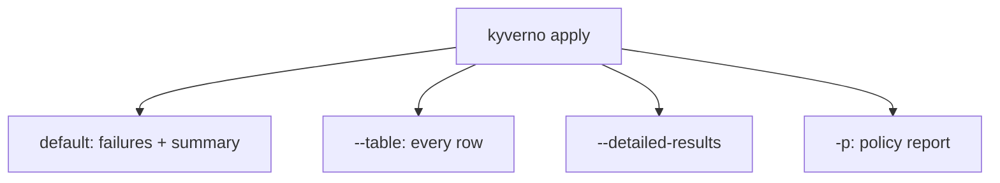

# Reading The Results

Astronaut, the exit code is for the machine. The crew needs more: which ship, which rule, and why. `kyverno apply` has several ways to print the answer. This part compares them, and ends with your graded mission.



One run, four ways to read it. Pick the one that fits the reader.

## The default output

<!-- astrona:playground:renew -->

Run the Enforce policy from part 1 on both Pods:

```sh
cd /root/apply-gate
kyverno apply clusterpolicy-require-team-label.yaml --resource legacy-app.yaml --resource compliant-app.yaml
```

The CLI prints the failure with its message and the path that failed, then the summary line. The passing Pod is only counted.

## `--table`

`-t` (long form `--table`) lists every resource as a row, with the policy, the rule, the resource and the result:

```sh
kyverno apply clusterpolicy-require-team-label.yaml --resource legacy-app.yaml --resource compliant-app.yaml --table
```

You see one row for `legacy-app` with `Fail` and one for `compliant-app` with `Pass`. The summary line is not printed in table mode. Redirect the table to a file when a human needs to read it later.

## `--detailed-results`

`--detailed-results` adds more detail for each result. The exact layout depends on the CLI version, so run it and read the screen:

```sh
kyverno apply clusterpolicy-require-team-label.yaml --resource legacy-app.yaml --resource compliant-app.yaml --detailed-results
```

Use it when you need to see why a rule failed, not only that it did.

## `--continue-on-fail`

By default the CLI can stop at a problem. `--continue-on-fail` tells it to carry on with the next resource when applying to the current one fails. Use it when you scan a whole folder and want every result, not only the first:

```sh
kyverno apply clusterpolicy-require-team-label.yaml --resource legacy-app.yaml --resource compliant-app.yaml --continue-on-fail
```

The exit code still says there were failures.

## `-p`: a policy report

`-p` (long form `--policy-report`) prints a report resource with one result per rule and resource, passing ones included:

```sh
kyverno apply clusterpolicy-require-team-label.yaml --resource legacy-app.yaml --resource compliant-app.yaml -p > report.yaml
```

Redirect it to a file to keep it. In `1.13.2` the report is a `ClusterPolicyReport`. Newer versions use another report API, so check the `kind` line at the top before you parse it.

## Which output for which reader

| Reader | Use |
| --- | --- |
| A pipeline step | The exit code |
| A person in a hurry | The default output |
| A person who wants every row | `--table` |
| A person who asks why | `--detailed-results` |
| A tool that reads structured data | `-p` |

## Common pitfalls

> [!WARNING]
> - **Looking for the summary line in `--table` mode.** The table replaces it.
> - **Pasting a report into a parser built for another version.** Check `kind` and `apiVersion` first.
> - **Forgetting to redirect.** The report goes to the screen. Use `> file` to keep it.
> - **Reading a skip as a pass.** An excused resource is `skip`.

## Your mission: Exceptions, Warnings & Exit Codes Lab

You can now excuse a ship with an exception, choose the exit code for warnings, and read the results in several forms. Prove it in a graded mission: write an exception that clears `legacy-app`, run an Audit policy with your own warning exit code, and save the results as a table.

Pause the playground first, so the mission has the memory it needs:

```sh
astrona stop ats-009-playground-020-03
```

Start the mission, then grade it when you think you are done:

```sh
astrona run --git ssh://git@github.com/astrona-io/ATS009.git -c sections/section-020/module-03/labs/lab-01
astrona submit -c sections/section-020/module-03/labs/lab-01
```

Read the task in [`question.md`](./labs/lab-01/question.md) and solve it on your own first. When the mission is done, remove it and start the playground again:

```sh
astrona destroy ats-009-lab-011
astrona start ats-009-playground-020-03
```
