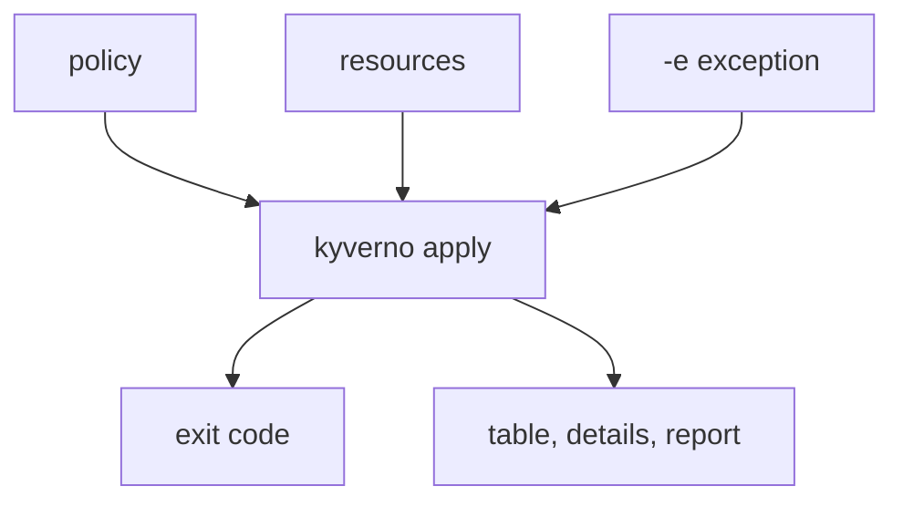

# Exceptions, Warnings And Exit Codes In Pipelines

Astronaut, a pipeline gate is a dock guard. It checks every ship against the rulebook and either waves it in or stops it. Two things make a real guard useful: it knows about written exceptions for special ships, and it reports back in a way a machine can read. `kyverno apply` gives you both. A `PolicyException` excuses one ship from one rule, and the exit code tells the pipeline what happened.

The command reads policies, resources and exceptions. It answers in two ways: an exit code for the pipeline and text for people.

## Learning objectives

After this module you can:

- Write a `PolicyException` and pass it to `kyverno apply` with `-e`/`--exception`.
- Turn the failure of an `Audit` policy into a warning with `--audit-warn`.
- Choose the exit code for warnings with `--warn-exit-code`, and know what `--warn-no-pass` adds.
- Predict the exit code of a run: `0` for clean, `1` for failures or errors, your own number for warnings.
- Read results in the form you need: `--table`, `--detailed-results`, and a policy report with `-p`.
- Explain what `--continue-on-fail` changes.

## Before you start

This module builds on `kyverno apply` with policy and resource files, and on the values file from the earlier parts of this section. The playground has the tool ready.

### What you should already know

- **How to run `kyverno apply` on a Pod file** and read its summary line (`pass`, `fail`, `warn`, `error`, `skip`).
- **The difference between `Enforce` and `Audit`** in `validationFailureAction`.
- **What an exit code is.** `echo $?` prints the code of the last command. `0` is success.

### What is waiting in your playground

The playground is a training solar system (a `kind` cluster) with the `kyverno` CLI `1.13.2`. It has no Kyverno controller. The files `legacy-app.yaml` (a Pod with no labels) and `compliant-app.yaml` (a Pod with the label `team: checkout`) are in `/root/apply-gate/`. You write the policies yourself. The graded mission starts its own cluster, with its own files.

## How this module is organised

1. **[Exceptions With -e](./course-01-exceptions-with-policy-exceptions.md)**: writing a `PolicyException` and passing it to `apply`.
2. **[Warnings And Exit Codes](./course-02-warnings-and-exit-codes.md)**: `--audit-warn`, `--warn-exit-code`, `--warn-no-pass` and the exit code table.
3. **[Reading The Results](./course-03-reading-the-results.md)**: `--table`, `--detailed-results`, `--continue-on-fail` and `-p`. It ends with your graded mission.
4. **[Summary](./course-04-summary.md)**: what you learned, your mission, questions to check yourself, and cleaning up the playground.

## Why this matters

A policy check in a pipeline lives or dies by its exit code. A gate that always says yes is useless, and a gate with no way to excuse one old ship gets switched off. The exam asks which flag does what.

<!-- astrona:playground -->
