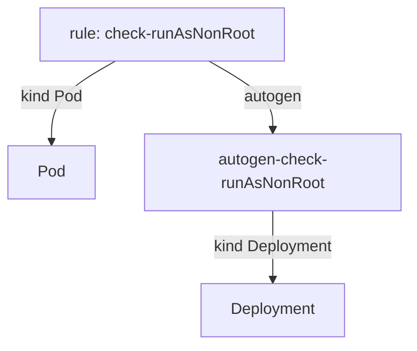

# Autogen Names, Foreach And Deny Rules

Astronaut, not every rule is as plain as "this field must have this value". Some rules are copied by Kyverno itself for other kinds of resources. Others check a whole list, such as every container in a Pod. This part shows what the `results` entry must say for these two shapes, so your checklist does not point at a rule that is not there.

You work in `~/kyverno-cli-lab`. The folder already has a Deployment named `web` in `web-deployment.yaml`, and a second policy in `no-privileged.yaml`. If you already wrote a `kyverno-test.yaml` there, it stays in the folder. Here you save the new manifests under other names and pick them with the `-f` flag.

## Rules that Kyverno writes for you

A policy rule that matches `Pod` also covers the objects that build Pods, such as Deployments and CronJobs. Kyverno writes extra copies of the rule for them. These are autogen rules: copies of a ship rule that Kyverno writes for the shipyards that build ships.



The diagram shows one written rule that applies to Pods, and an extra rule with the prefix `autogen-` that applies to Deployments.

The copy has its own name: `autogen-` followed by the original name. A cron job gets `autogen-cronjob-` followed by the original name. The `rule` field of a `results` entry must use that full name, because it is the name Kyverno reports.

### Test the Deployment

Check the Deployment first. It is in `web-deployment.yaml`, and its Pod template has no `securityContext`:

<!-- astrona:playground:renew -->

```sh
cd ~/kyverno-cli-lab
cat web-deployment.yaml
```

Save this as `deployment-test.yaml`. The policy file is the same one as before, and the rule name carries the `autogen-` prefix:

```yaml
apiVersion: cli.kyverno.io/v1alpha1
kind: Test
metadata:
  name: deployment-tests
policies:
  - require-run-as-nonroot.yaml
resources:
  - web-deployment.yaml
results:
  - policy: require-run-as-nonroot
    rule: autogen-check-runAsNonRoot
    resources:
      - web
    kind: Deployment
    result: fail
```

Run it with `-f`, which picks a manifest by its file name:

```sh
kyverno test . -f deployment-test.yaml
```

The table has one row. The `RULE` column shows `autogen-check-runAsNonRoot`, the `RESOURCE` column names the Deployment `web`, and the test passes because the Deployment really fails the rule. Rule names with an `autogen-` prefix are not in the policy file, so read them from the table of a run when you are not sure.

## Rules that check a list

A `foreach` rule loops over a list inside the resource, such as the containers of a Pod. A `deny` block says when the request is turned away. For the test, the rule is still one rule with one verdict per resource: if any item trips the `deny` condition, the whole resource gets `fail`.

`no-privileged.yaml` holds a rule named `check-privileged` that denies a Pod when one of its containers runs privileged, which means with almost the rights of the host ship. `privileged-pod.yaml` has such a container. `calm-pod.yaml` does not.

Save this as `foreach-test.yaml`:

```yaml
apiVersion: cli.kyverno.io/v1alpha1
kind: Test
metadata:
  name: foreach-tests
policies:
  - no-privileged.yaml
resources:
  - privileged-pod.yaml
  - calm-pod.yaml
results:
  - policy: no-privileged
    rule: check-privileged
    resources:
      - privileged-pod
    kind: Pod
    result: fail
  - policy: no-privileged
    rule: check-privileged
    resources:
      - calm-pod
    kind: Pod
    result: pass
```

Run it:

```sh
kyverno test . -f foreach-test.yaml
```

Both rows show `Pass`. As always, that means each claim matched: `privileged-pod` really fails the rule, and `calm-pod` really passes it.

### See what a wrong claim looks like

Change the `privileged-pod` entry to `result: pass` and run the same command again. The row for `privileged-pod` now shows `Fail` with the reason `Want pass, got fail`, and the exit code is not `0`. Change it back to `result: fail` before you go on.

## Common pitfalls

> [!WARNING]
> - **Writing the plain rule name for a Deployment.** The rule that checks a Deployment is `autogen-` plus the original name. Copy the name from the `RULE` column of a run.
> - **Forgetting `kind: Deployment`.** The `kind` field of the entry must be the kind of the resource, not the kind the rule was written for.
> - **Expecting one verdict per list item.** A `foreach` rule gives one verdict per resource. One bad container makes the whole Pod fail.
> - **Leaving a flipped claim in place.** If you turned a claim around to see the failure, turn it back.
