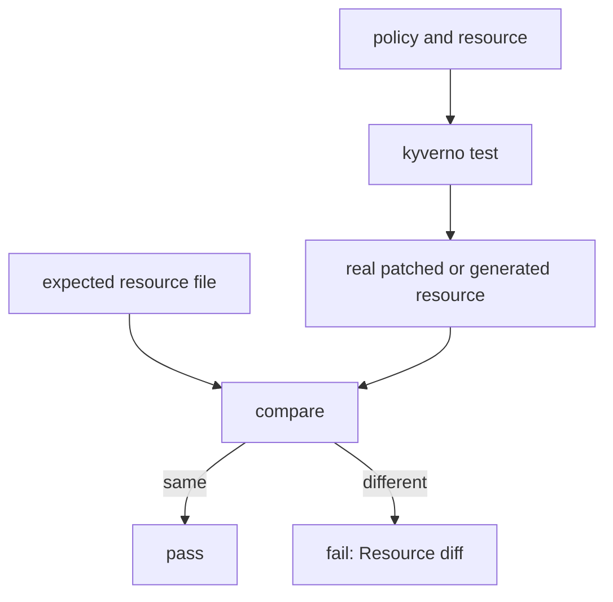

# Testing Mutate and Generate Rules

Astronaut, a `validate` rule only says yes or no. Mutate and generate rules do real work: a mutate rule changes the ship's papers on the way in, and a generate rule builds something new when a planet appears. A test for such a rule cannot only say "pass". It must also say what the changed ship looks like, or what was built. `kyverno test` can check both, on plain files, without a cluster.

This module shows you how to write those checks. It uses the same pre-flight checklist you know: a `kyverno-test.yaml` with the expected answer next to every line. The new part is that the answer can be a whole resource.

The test builds the real result, then compares it with the file you wrote. A difference of one value is enough to fail.

## Learning objectives

After this module you can:

- Write a `results` entry for a mutate rule with `patchedResources`, and explain what the expected file must hold.
- Test that a mutate rule leaves a resource alone with `result: skip`.
- Write a `results` entry for a generate rule with `generatedResource`.
- Test a clone rule with `cloneSourceResource`, and explain why it needs a source file.
- Read the `Resource diff` reason and tell which side, the claim or the policy, is wrong.

## Before you start

### What you should already know

- **How a `kyverno-test.yaml` is built.** It lists `policies`, `resources` and `results`, and each `results` entry names a policy, a rule, resource names, a kind and a result.
- **What mutate and generate rules do.** A mutate rule is a repair crew that fixes a ship's papers before the ship docks. A generate rule is a dock crew that builds a standard structure on every new planet.

### What is waiting in your playground

Your playground is a terminal with the `kyverno` CLI `1.13.2` and a practice folder, `~/kyverno-cli-lab`. The folder holds these files:

| File | What it is |
| --- | --- |
| `add-managed-by.yaml` | `ClusterPolicy` with mutate rule `set-managed-by` |
| `web-pod.yaml` | A Pod labelled `tier: web` |
| `batch-pod.yaml` | A Pod labelled `tier: batch` |
| `add-default-deny.yaml` | `ClusterPolicy` with generate rule `create-default-deny` |
| `team-a-namespace.yaml` | A Namespace named `team-a` |
| `clone-registry-secret.yaml` | `ClusterPolicy` with clone rule `copy-regcred` |
| `team-b-namespace.yaml` | A Namespace named `team-b` |
| `regcred-source.yaml` | The `Secret` that the clone rule copies |

There is no test manifest and there are no expected-output files: you write them. The graded mission at the end of the module uses its own cluster and folder.

## How this module is organised

1. **[Testing Mutate Rules](./course-01-testing-mutate-rules.md)**: the expected patched resource, the `skip` result, and how to read a `Resource diff`.
2. **[Testing Generate Rules](./course-02-testing-generate-rules.md)**: the expected generated resource, and the source file a clone rule needs. It ends with your graded mission.
3. **[Summary](./course-03-summary.md)**: what you learned, your mission, questions to check yourself, and cleaning up.

## Why this matters

A mutate rule that quietly stops painting a label, or a generate rule that builds the wrong network rule, does not make any request fail. The damage shows up later. A test that holds the expected result catches the change on the day someone makes it.

Launch your playground now, and keep it running next to you while you read the parts:

<!-- astrona:playground -->
