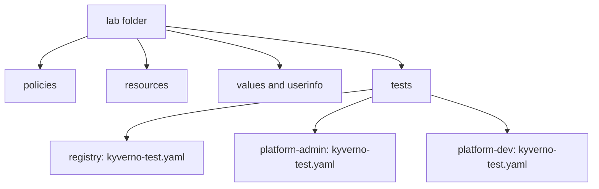

# Organising Large Test Suites

Astronaut, one checklist is easy to read. Forty checklists in one pile are not. A real fleet has many policies, many ships and many badges, and every one of them needs its own claims. This part shows how to keep them in order, how to run them all with one command, and how to stop a launch checklist from passing when nobody wrote it.

You work in `~/kyverno-cli-lab`.

## One folder for each scenario

So far you used the flag `-f` to pick a manifest by its file name. That works for a few files, but it does not scale. The better habit is one folder for each scenario, and in every folder one manifest with the standard name `kyverno-test.yaml`.



The inputs live once, in shared folders. Each scenario in `tests` holds only a manifest that points at them.

`kyverno test .` looks into the folder, and into every folder below it, for files named `kyverno-test.yaml`. It runs them all and gives one summary and one exit code.

## Move one suite into a folder

Take the admin suite that you wrote with a badge. Make its folder and write the manifest there. The paths are now relative to `tests/platform-admin`, so they climb two folders up:

<!-- astrona:playground:renew -->

```sh
cd ~/kyverno-cli-lab
mkdir -p tests/platform-admin
```

Save this as `tests/platform-admin/kyverno-test.yaml`:

```yaml
apiVersion: cli.kyverno.io/v1alpha1
kind: Test
metadata:
  name: platform-admin-tests
policies:
  - ../../policies/platform-admin-only.yaml
resources:
  - ../../resources/platform-pod.yaml
userinfo: ../../userinfo/admin.yaml
results:
  - policy: platform-admin-only
    rule: block-platform-tier
    resources:
      - platform-pod
    kind: Pod
    result: skip
```

Run everything from the top folder:

```sh
kyverno test .
```

The summary counts the tests of this manifest. The other files, such as `admin-test.yaml` in the top folder, are not run, because their name is not `kyverno-test.yaml`. Move the other suites the same way, one folder each, and run `kyverno test .` again. The summary now counts all of them, and a single wrong claim in any folder makes the exit code non-zero.

> [!NOTE]
> Keep the inputs shared. If every scenario folder holds its own copy of the policy, a fix has to be made in many places, and the copies drift apart.

## Narrow a run

When one claim fails in a big suite, you do not want to read every row. Use `--test-case-selector`. It filters by policy, rule and resource:

```sh
kyverno test . --test-case-selector "policy=restrict-registry, rule=check-registry, resource=legacy-pod" --detailed-results
```

Use it while you debug. Do not put it into the pipeline, because a narrow run is not a full gate.

## Guard against an empty suite

An empty folder gives the message `No test yamls available` and exit code `0` in `1.13.2`. A launch checklist that nobody wrote passes. The pipeline itself must check that the manifests exist. A small script is enough:

```sh
#!/usr/bin/env bash
set -eu
count=$(find . -name kyverno-test.yaml | wc -l)
if [ "${count}" -lt 1 ]; then
  echo "No kyverno-test.yaml found"
  exit 1
fi
kyverno test .
```

The script is the console light for the whole suite: red if there are no tests, red if any claim is wrong, green otherwise.

## Keep a large suite honest

Three habits keep a large suite useful:

- **One claim per line of meaning.** Group resources in one `results` entry only when they truly share a verdict.
- **A passing and a failing resource for every rule.** A rule with only a `pass` test could be a rule that always passes.
- **Names that explain.** Folder names such as `platform-admin` and resource names such as `legacy-pod` tell the next reader what each test is about.

## Your mission: Variables, Exceptions And Suites Lab

You can now supply variables, badges and waivers, and you can keep many suites in order. The mission starts a folder with two policies, an exception, four Pods, a values file and two badges. You write three test manifests in three folders under `tests`: a registry suite with a variable and an exception, an admin suite and a developer suite. One `kyverno test .` from the top folder must run all of them.

Pause the playground first, so the lab has the memory it needs:

```sh
astrona stop ats-009-playground-030-03
```

Start the mission, read the task in `question.md`, and send it for grading when you are done:

```sh
astrona run --git ssh://git@github.com/astrona-io/ATS009.git -c sections/section-030/module-03/labs/lab-01
astrona submit -c sections/section-030/module-03/labs/lab-01
```

When you are done, remove the lab and start the playground again:

```sh
astrona destroy ats-009-lab-013
astrona start ats-009-playground-030-03
```

## Common pitfalls

> [!WARNING]
> - **Writing paths from the wrong folder.** Paths are relative to the manifest. A manifest in `tests/registry` must use `../../policies/...`.
> - **Naming a manifest anything but `kyverno-test.yaml` and expecting `kyverno test .` to find it.** Only files with the standard name are found, unless you pick them with `-f`.
> - **Copying the policy into every scenario folder.** Share the inputs. One policy file, many manifests.
> - **Trusting a green run that found no tests.** On `1.13.2`, an empty folder exits `0`. Check that the manifests exist.
> - **Using `--test-case-selector` in the pipeline.** It narrows the run. The gate must run everything.
