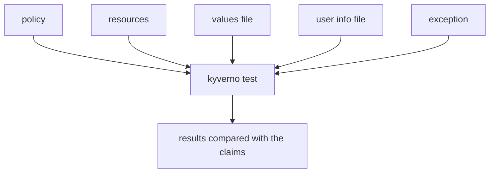

# Variables, User Info, Exceptions And Large Suites

Astronaut, a real fleet rulebook is not made of rules that only look at one ship. Some rules need a fact from mission control, such as the approved shipyard. Some depend on who asks, such as a cluster admin. Some have a signed waiver for one old ship. A pre-flight checklist for those rules must supply the missing facts, the crew badge and the waiver, because the offline test has no cluster to ask.

This module shows you how to give the test those things, and how to keep many checklists in order when the fleet grows.

Each extra input is one more file that the checklist points to. The test reads all of them, runs the rules, and compares the verdicts with your claims.

## Learning objectives

After this module you can:

- Supply policy variables to a test with a `Values` file and the `variables` field.
- Test a rule that depends on the requester with a `UserInfo` file and the `userinfo` field.
- Test a `PolicyException` with the `exceptions` field, and claim `skip` for the excepted resource.
- Name the four reasons a rule can be skipped, and tell them apart.
- Organise many test manifests in folders, run all of them with one command, and narrow a run while debugging.
- Explain how to stop a pipeline from passing when it finds no tests.

## Before you start

### What you should already know

- **How a `kyverno-test.yaml` is built.** It lists `policies`, `resources` and `results`.
- **What a `context` entry is.** It is information the inspector radios mission control for during an inspection. Offline, there is no mission control, so the test must hand over the answer.

### What is waiting in your playground

Your playground is a terminal with the `kyverno` CLI `1.13.2` and a practice folder, `~/kyverno-cli-lab`. The folder holds these files:

| File | What it is |
| --- | --- |
| `policies/restrict-registry.yaml` | `ClusterPolicy` with rule `check-registry` and a `ConfigMap` context entry |
| `policies/platform-admin-only.yaml` | `ClusterPolicy` with rule `block-platform-tier` |
| `policies/legacy-exception.yaml` | A `PolicyException` for `legacy-pod` |
| `resources/good-registry-pod.yaml` | A Pod with an approved image |
| `resources/bad-registry-pod.yaml` | A Pod with an image from the wrong registry |
| `resources/legacy-pod.yaml` | An old Pod with an image from the wrong registry |
| `resources/platform-pod.yaml` | A Pod labelled `tier: platform` |
| `values/registry-values.yaml` | The value of the registry variable |
| `userinfo/admin.yaml` | The crew badge of a cluster admin |
| `userinfo/dev.yaml` | The crew badge of a developer |

There is no test manifest yet: you write them. The graded mission at the end of the module uses its own cluster and folder.

## How this module is organised

1. **[Variables And User Info](./course-01-variables-and-user-info.md)**: the values file and the user info file, and what happens when a variable is missing.
2. **[Exceptions And Skip Results](./course-02-exceptions-and-skip-results.md)**: how to test a `PolicyException`, and the four reasons for `skip`.
3. **[Organising Large Test Suites](./course-03-organising-large-test-suites.md)**: folders, one command for all suites, narrowing a run, and a gate against an empty suite. It ends with your graded mission.
4. **[Summary](./course-04-summary.md)**: what you learned, your mission, questions to check yourself, and cleaning up.

## Why this matters

Most real policies need a fact from outside the resource. A suite that cannot supply that fact either skips the rule or fails for the wrong reason. Once the suite can supply it, it can also grow, and then order matters: a hundred manifests in one folder are as hard to read as a hundred pages without chapters.

Launch your playground now, and keep it running next to you while you read the parts:

<!-- astrona:playground -->
