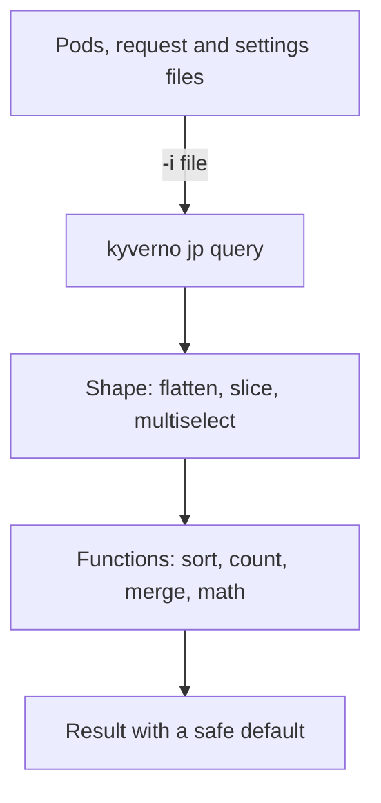

# Advanced JMESPath: Functions, Projections And Real Policy Data

Astronaut, the first module taught you to read one star on a chart. Real policies read whole fleets: every Pod in a list, every label of an object, a limit written as `256Mi`, a token packed in base64. This module gives the navigation computer the harder moves, using data shaped like the data a Kyverno policy really sees.

You hand the computer a fleet; it reshapes it, runs the functions, and gives back one answer you can trust in a policy.

## Learning objectives

After this module you can:

- Flatten lists, take slices, and build new lists and objects with multiselects.
- Write keys that contain dots and slashes with double quotes.
- Sort, count, merge and convert values with the built-in functions, and combine tests with `&&`, `||` and `!`.
- Use Kyverno's functions on real data: `parse_json`, `base64_decode`, `path_canonicalize`, quantity math, `time_since` and `object_from_lists`.
- Give a missing key a default with `||`, query a request file, and debug with `-q`, `-c`, `-u`, `kyverno jp parse` and `kyverno jp function`.

## Before you start

This module builds on the basics of `kyverno jp query`: dot notation, `[*]` projections, `[?...]` filters and the difference between `'text'` and `` `9` ``. You should be comfortable reading JSON.

### What is waiting in your playground

The playground starts a training solar system with Kyverno and the `kyverno` command-line tool `1.13.2`. In `~/jp-playground/` you find three files: `pods.json` (a list of three Pods), `request.json` (an admission request) and `settings.json` (a string of JSON, a base64 token, a path and a start time). Every command in the parts runs there. The graded mission at the end of the fourth part starts a separate environment with its own copies of the files.

## How this module is organised

1. **[Shaping Lists And Objects](./course-01-shaping-lists-and-objects.md)**: flatten, slices, `.*`, `keys`, multiselects and quoted keys.
2. **[Sorting, Counting And Combining With Built-In Functions](./course-02-stock-functions-for-sorting-counting-and-combining.md)**: `sort_by`, `max_by`, `length`, `join`, `contains`, `merge`, and the logic operators.
3. **[Kyverno Functions On Real Policy Data](./course-03-kyverno-functions-on-real-policy-data.md)**: `parse_json`, base64, paths, quantity and time math, `object_from_lists`.
4. **[Defaults, Requests And Debugging Tools](./course-04-defaults-requests-and-debugging-tools.md)**: `||` defaults, request files, `-q`, `jp parse`, and your graded mission.
5. **[Summary](./course-05-summary.md)**: what you learned, your mission, and cleaning up.

## Why this matters

A policy that works on one sample Pod can fail on the second one, because a label is missing or a list is nested. Trying the expression on a whole fleet of sample data first catches those cases in seconds.

<!-- astrona:playground -->
